# Approach 2 Overfit (re10k_overfit5)

Date: 2026-11-13. Branch `approach2-score-head`. Ticket A2-13.

## Setup

- Frozen DepthSplat small (256x256, 2 views), score head U-Net `[32, 64, 96, 128]`,
  **1,192,033 params**, random init. Input: raw `gaussian_head` output (37 ch) + log depth.
- Training: `scripts/a2_overfit.sh` on the 5 overfit scenes, batch 4, 3000 steps, AdamW lr 3e-4
  (OneCycle), `k ~ U[0.01, 1]`, Gumbel top-k with `T = 1.0`, mask rasterizer (patched backward).
- Validation during training: 10 heldout scenes (`assets/evaluation_index_a2_val10.json`).
- Eval: `scripts/a2_eval.sh`, final checkpoint `epoch_1499-step_3000.ckpt`, stock rasterizer,
  hard top-`N_k` per scene. Every method keeps exactly `N_k = floor(k * 131072)` Gaussians.

## First run diverged (fixed)

- `train/score_std` went 0.0016 -> 75.8 (step 29) -> `inf` (step 119); the head then got zero
  gradient and the score cut stayed below random (`val/psnr@0.1` fixed at 6.55 dB).
- Cause: per-scene standardization `z = (s - mean) / std` with **detached** mean/std. The loss
  depends only on `z`, but with a detached std the gradient still had a component along `s`, so
  the score scale grew ~x2-3 per step until fp32 overflow.
- Fix `b8be546`: mean/std not detached (gradient has no scale component), with a regression test.
  After the fix `score_std` stays in 0.0016-0.0085 for all 3000 steps.

## Results (step 3000)

PSNR / SSIM / LPIPS, mean over scenes.

**overfit5 (training scenes, 5)**

| k | kept | score | random | opacity |
|---|---|---|---|---|
| 0.05 | 6553 | **10.25** / .301 / .609 | 6.33 / .069 / .725 | 5.41 / .030 / .735 |
| 0.1 | 13107 | **12.13** / .379 / .559 | 8.07 / .142 / .688 | 6.00 / .072 / .712 |
| 0.25 | 32768 | **16.43** / .604 / .370 | 12.57 / .320 / .581 | 8.35 / .241 / .598 |
| 0.5 | 65536 | **23.89** / .819 / .187 | 19.45 / .582 / .401 | 14.60 / .615 / .345 |
| 1.0 | 131072 | 29.73 / .905 / .090 | 29.73 / .905 / .090 | 29.73 / .905 / .090 |

**heldout10 (unseen scenes, 10)**

| k | kept | score | random | opacity |
|---|---|---|---|---|
| 0.05 | 6553 | **10.78** / .350 / .560 | 6.92 / .082 / .709 | 6.01 / .039 / .699 |
| 0.1 | 13107 | **12.26** / .418 / .515 | 8.51 / .146 / .680 | 6.64 / .085 / .675 |
| 0.25 | 32768 | **15.91** / .577 / .382 | 12.93 / .329 / .585 | 9.04 / .270 / .561 |
| 0.5 | 65536 | **20.54** / .748 / .236 | 19.11 / .588 / .418 | 14.23 / .580 / .350 |
| 1.0 | 131072 | 25.69 / .855 / .122 | 25.69 / .855 / .122 | 25.69 / .855 / .122 |

Gate (score beats random and opacity in mean PSNR at k = 0.05, 0.1, 0.25 on overfit5): **met**,
by +3.9 to +4.1 dB over random and +4.8 to +8.1 dB over opacity. It also holds on heldout10
and at k = 0.5.

## Training curve (heldout10, score minus random PSNR, dB)

| step | k=0.05 | k=0.1 | k=0.25 | k=0.5 |
|---|---|---|---|---|
| 249 | +3.03 | +2.59 | +1.29 | -0.48 |
| 999 | +3.70 | +3.55 | +2.72 | +0.73 |
| 1999 | +3.80 | +3.68 | +2.93 | +1.28 |
| 2999 | see table above (eval) | | | |

Small budgets flatten after ~1000 steps; k = 0.5 still improves at step 3000.

## Cost

- Head runtime: **5.0 ms** per scene (encoder: 67 ms), RTX 2080 Ti.
- Peak eval memory: 1444 MB. Training at batch 4: 6923 MiB peak.
- 3000 steps incl. validation: 45 min (~1.1 steps/s).

## Outputs

`outputs/approach2/overfit5_fix1/` (checkpoints, `tensorboard/`, `eval_overfit5/`, `eval_heldout10/`).
A 500-step check run is in `outputs/approach2/overfit5_fix1_500/`; the diverged run in
`outputs/approach2/overfit5/` is invalid.

## 1-scene overfit (varying budget)

`scripts/a2_overfit1.sh`: scene `41b80c5fb43019e5`, fixed views (context 122/167, targets
136/145/160, as A1's 1-scene run), no augmentation, batch 1, `k ~ U[0.01, 1]`, 3000 steps
(~8 min, 6.5 steps/s). Validation and eval on the same scene and views. Step-3000 checkpoint,
PSNR / SSIM / LPIPS:

| k | score | random | opacity |
|---|---|---|---|
| 0.05 | **11.43** / .460 / .544 | 5.44 / .062 / .793 | 4.34 / .032 / .740 |
| 0.1 | **13.45** / .559 / .469 | 7.69 / .152 / .748 | 4.65 / .069 / .723 |
| 0.25 | **19.67** / .766 / .317 | 12.26 / .364 / .611 | 6.33 / .243 / .624 |
| 0.5 | **28.00** / .920 / .131 | 19.08 / .640 / .414 | 13.53 / .648 / .365 |
| 1.0 | 30.32 / .948 / .080 | 30.32 / .948 / .080 | 30.32 / .948 / .080 |

One head serves all budgets. Validation PSNR plateaus after ~2000 steps; `score_std` stays in
0.0017-0.0115. Outputs: `outputs/approach2/overfit1/`.

1-scene head on the 10 unseen heldout scenes (PSNR): k=0.05 9.99, k=0.1 11.23, k=0.25 14.56,
k=0.5 19.37 (random 6.92 / 8.51 / 12.93 / 19.11; the 5-scene head is ~1 dB better).

## Comparison grids

Rows: score, random, opacity cut. Columns: GT, k = 0.05, 0.1, 0.25, 0.5, 1.0 (per-view PSNR in
each label). Made with `scripts/a2_eval.sh ... approach2.save_grids=true`.

The score cut keeps detailed regions (furniture, edges, windows) and drops flat ones (walls,
ceiling), which render as black or blurred holes at small k. Random leaves salt-and-pepper
holes everywhere; opacity drops whole regions.

**1-scene head, its training scene (3 target views)**

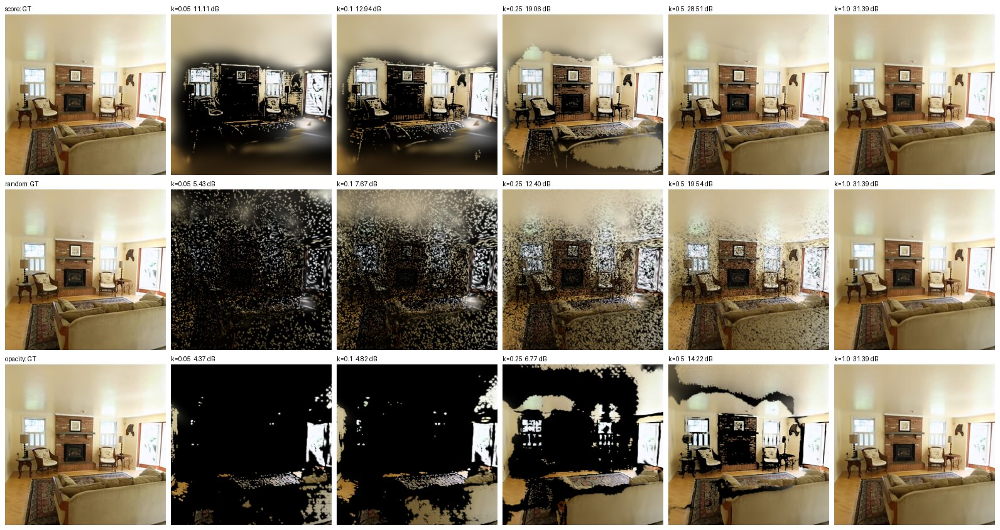

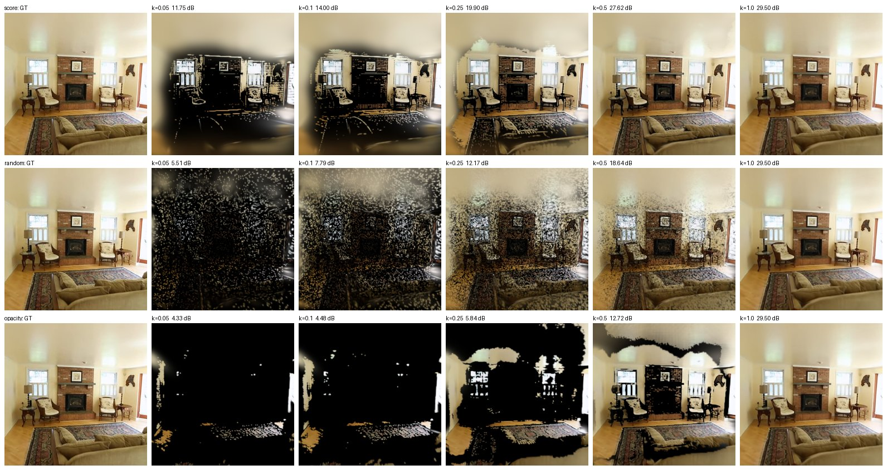

**5-scene head, unseen heldout scenes (target view 1 of each)**

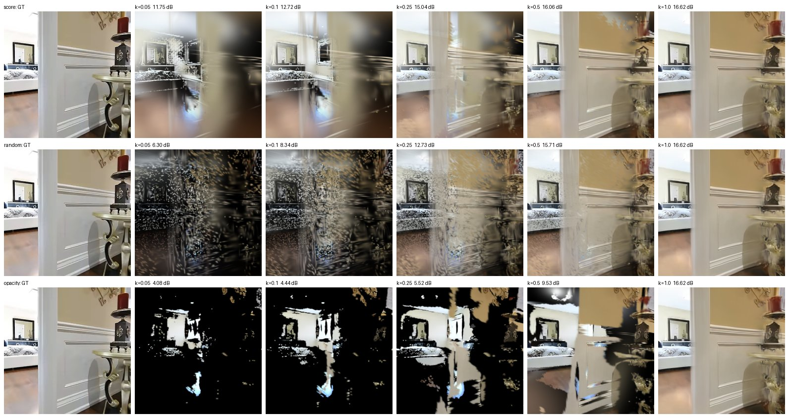
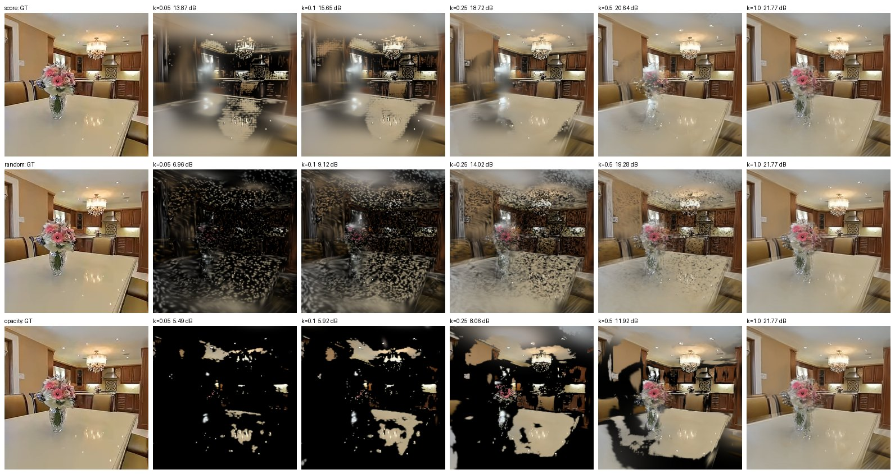
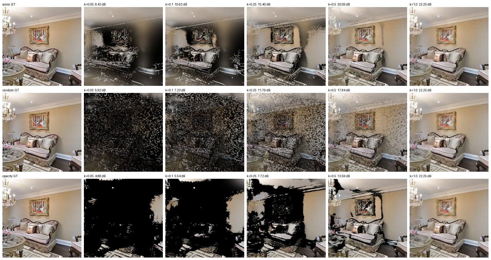
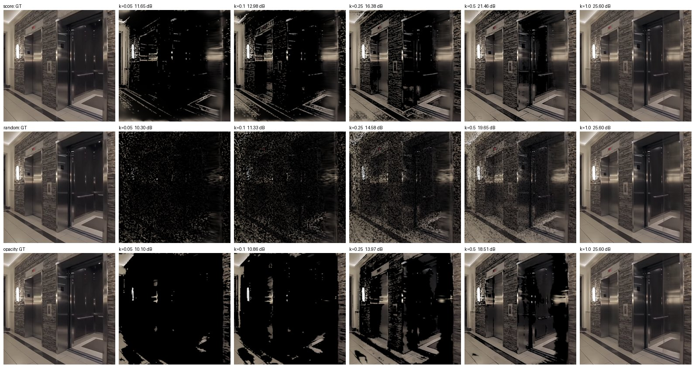
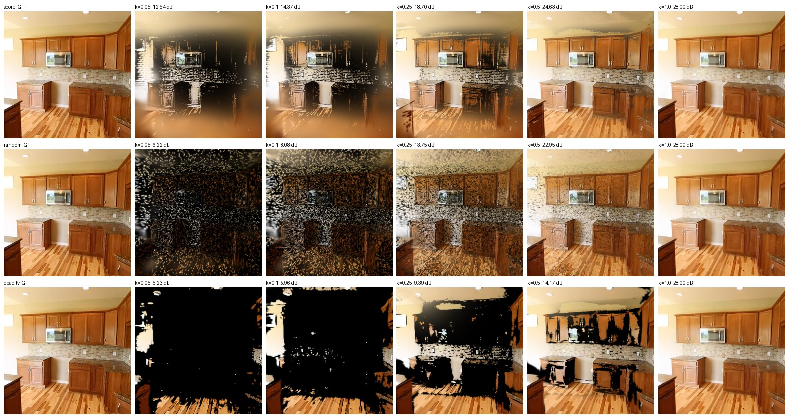
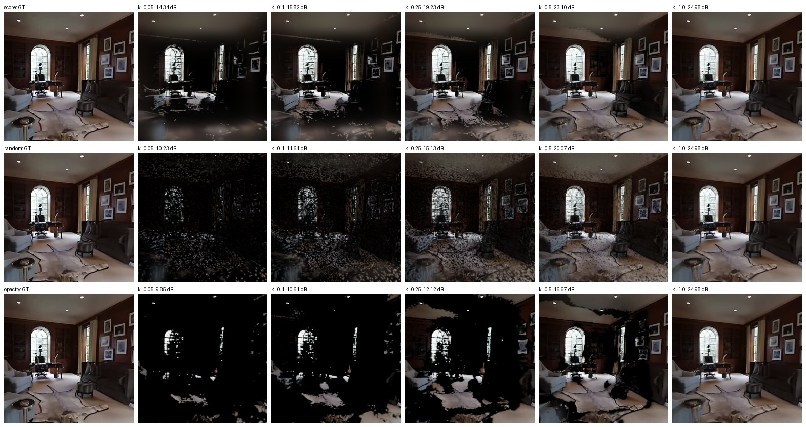
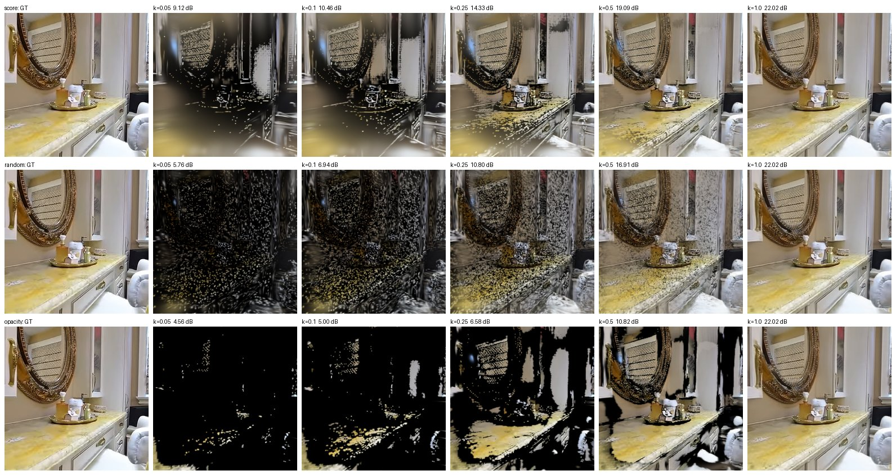
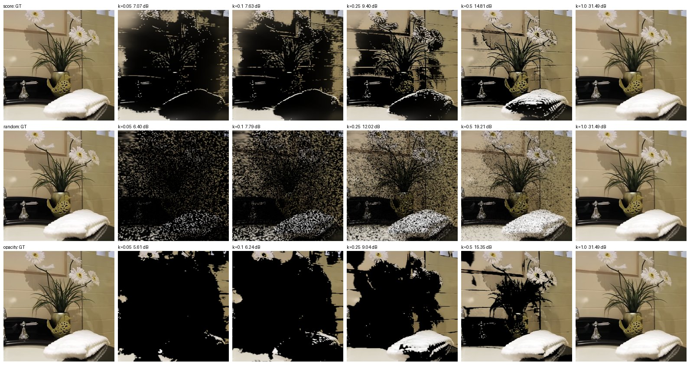
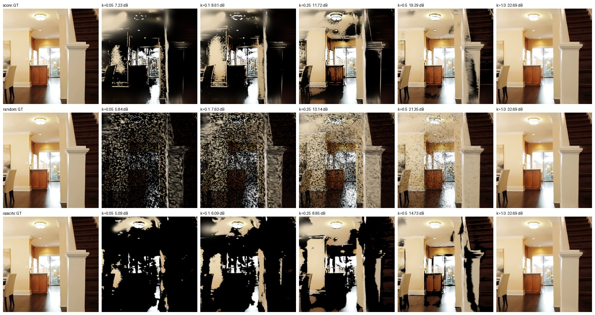
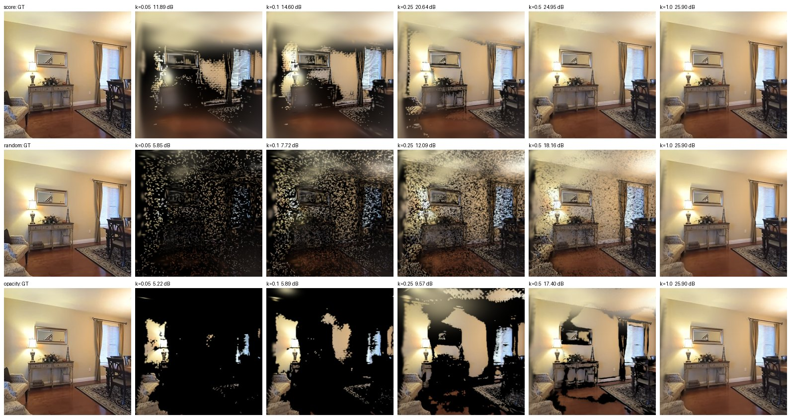
