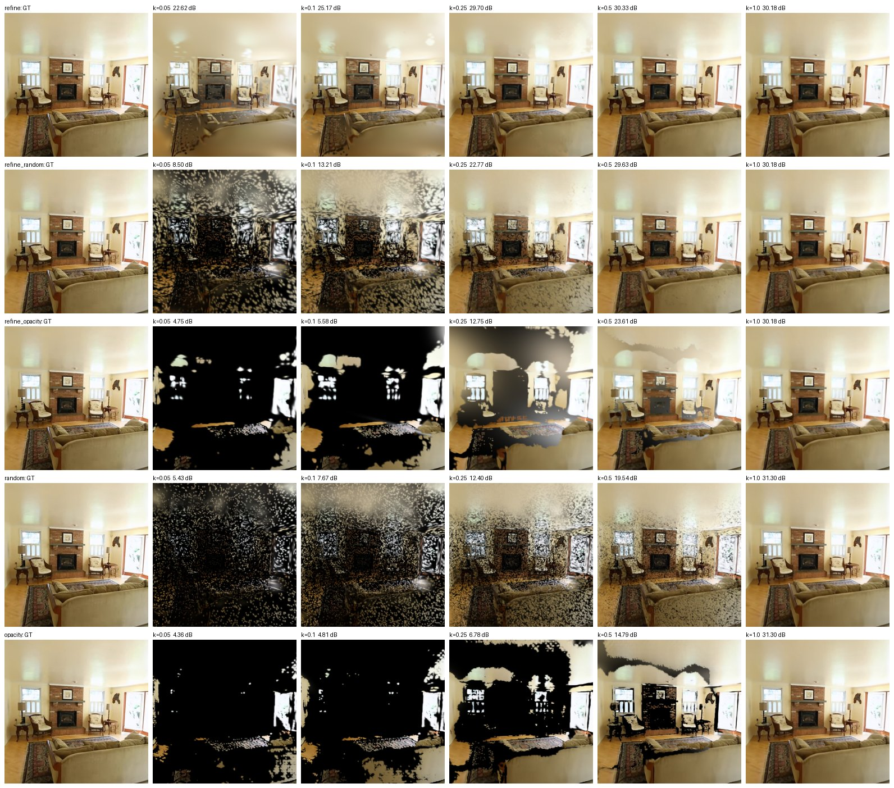
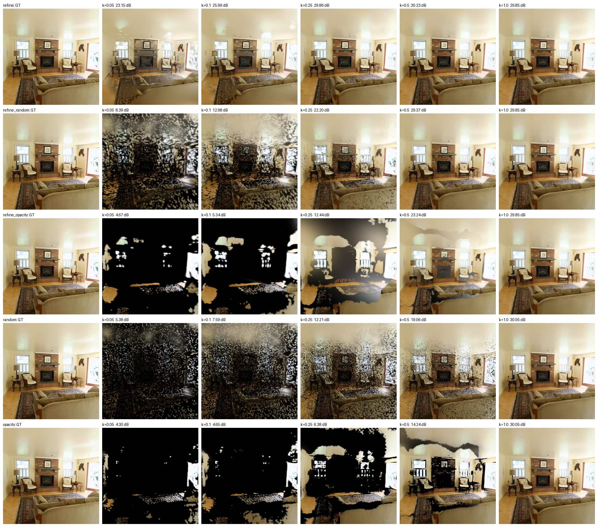
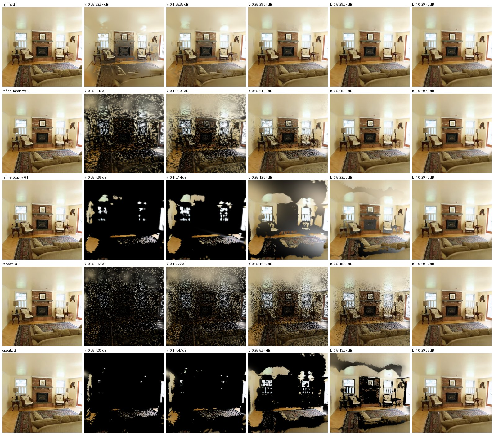
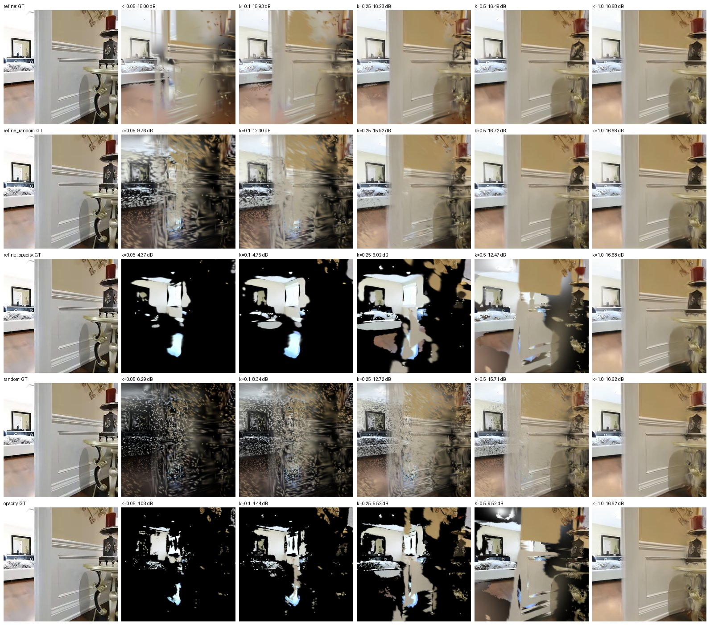
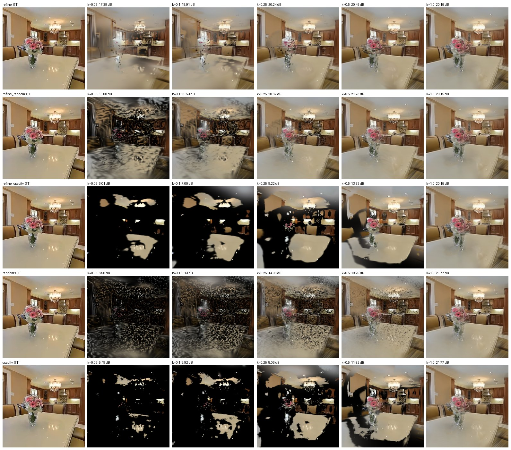
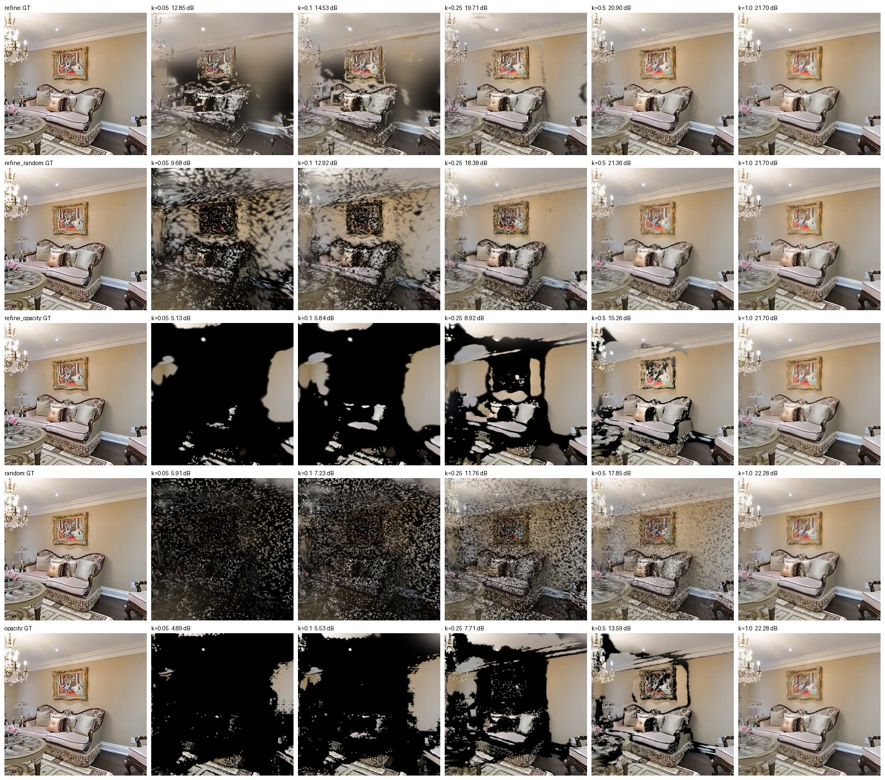
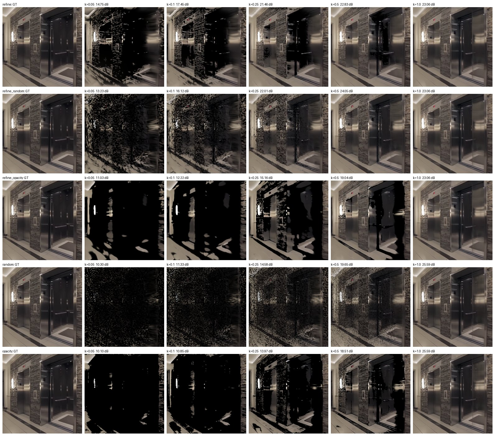

# Approach 2 Refine Head: Overfit Results (G0, G1, G2)

Date: 2026-11-17. Branch `approach2-score-head`. Spec:
`docs/superpowers/specs/2026-11-17-approach-2-refine-head-design.md`. Tickets A2R-07..A2R-09.

## Summary

- All three gates pass (G0 wiring/precision, G1 1-scene, G2 5-scene on unseen scenes).
- G2 on heldout10: `refine` beats the A2 v1 score cut and the frozen random cut at k = 0.05 / 0.1 / 0.25
  (14.19 / 16.86 / 20.98 dB vs. v1 10.78 / 12.26 / 15.90 and random 6.92 / 8.51 / 12.92).
- Most of the gain at k >= 0.25 comes from the **corrected Gaussians, not from the ranking**:
  `refine_random` (random cut on the corrected Gaussians) is 21.30 dB at k = 0.25, above `refine`
  (20.98 dB).
- Cost: with all Gaussians kept (k = 1) `refine` is 2.47 dB below frozen DepthSplat on heldout10
  (23.16 vs 25.63 dB), and Gaussians grow (scale ratio p99 5.4x). This is the "budget-independent
  compromise" risk of spec section 10.
- The budget `k` is **not** a head input in this version. Voxel merging and post-hoc pruning
  baselines are deferred until after full training. Full RE10K training (A2R-11) is not started.

## What the refine head is (short recap)

The A2 v1 head only predicts a score per Gaussian (the top-`N_k` are kept, unchanged). The refine
head also predicts a **residual** `delta` (37 channels: opacity logit, xy offset, scale, rotation,
SH) added to the frozen `gaussian_head` output, `raw' = raw + delta`, plus one score. The
Gaussians are then sorted and cut by the score. The final conv's `delta` rows start at zero, so
the untrained head reproduces frozen DepthSplat exactly (tested). DepthSplat itself stays frozen.

Terms used below:

- `refine`: corrected Gaussians, cut by the learned score.
- `refine_random`: the same corrected Gaussians, cut randomly. It isolates how much of the gain
  comes from the corrections alone; `refine` minus `refine_random` is the value of the ranking.
- `refine_opacity`: corrected Gaussians, sorted by corrected opacity (the "sort by opacity" ablation).
- `random`, `opacity`: frozen (uncorrected) Gaussians, cut randomly / by frozen opacity.
- `score` (v1): the A2 v1 head, frozen Gaussians, re-evaluated in fp16 for a matched comparison.
- `scale_ratio`: corrected activated Gaussian scale divided by the frozen one, per Gaussian
  (p50 = median, p99 = 99th percentile, max). 1.0 means unchanged; large values mean the head
  inflates Gaussians.

## Setup

- Frozen DepthSplat small (256x256, 2 views). Head: the A2 v1 U-Net `[32, 64, 96, 128]` with 38
  output channels. **1,193,254 trainable params** (v1: 1,192,033; +1,221 for the extra output rows).
- Precision `approach2.precision=16-mixed`: backbone and head in fp16; Gaussian adapter, Gumbel
  mask, both rasterizers, loss and metrics in fp32.
- Training: `scripts/a2_overfit1.sh` (1 scene, batch 1) and `scripts/a2_overfit.sh` (5 scenes,
  batch 4), 3000 steps each, `k ~ U[0.01, 1]`, Gumbel top-k with `T = 1.0`, MSE + 0.05 LPIPS,
  AdamW 3e-4. Eval: hard top-`N_k`, stock rasterizer, `N_k = floor(k * 131072)`.
- Training runtime: 1 scene ~9.4 min (5.6 it/s); 5 scenes ~51 min. No NaN/inf in either log.
- Outputs: `outputs/approach2/refine_g0/`, `refine_overfit1/`, `refine_overfit5/`.

### G0: tests and fp16 sanity

72 tests passed, all values finite. On heldout10, frozen DepthSplat at k = 1 in fp16 is 25.628 dB
vs. fp32 25.687 dB (diff -0.059 dB, limit 0.1). fp16 `refine_random` at k = 0.05 (6.922 dB) differs from
fp32-reference `random` by 0.002 dB; zero-init `refine@0.05` is 6.255 dB (constant score), 0.67 dB
below. **G0: PASS.**

Precision note: the earlier v1 fp16 numbers were produced with an fp16 Gaussian adapter in score
mode (only refine mode wrapped it in fp32). That was fixed (the adapter runs in fp32 in both modes)
and the three v1 fp16 evals were re-run. The v1 table rows are the new numbers, and the v1 frozen
`random@1.0` now equals the refine runs' (30.289 on the 1-scene scene, 25.628 on heldout10), so
all methods in a comparison use the same precision.

## G1: 1 scene (training scene `41b80c5fb43019e5`)

PSNR / SSIM / LPIPS, 3 target views.

| k | kept | refine | refine_random | refine_opacity | random (frozen) | score (v1, fp16) |
|---|---|---|---|---|---|---|
| 0.05 | 6553 | **22.88** / .772 / .324 | 8.44 / .145 / .697 | 4.69 / .058 / .728 | 5.44 / .062 / .794 | 11.40 / .459 / .543 |
| 0.1 | 13107 | **25.66** / .842 / .228 | 13.06 / .361 / .578 | 5.35 / .114 / .699 | 7.68 / .151 / .748 | 13.43 / .558 / .470 |
| 0.25 | 32768 | **29.63** / .911 / .139 | 22.16 / .765 / .281 | 12.41 / .543 / .519 | 12.26 / .363 / .612 | 19.64 / .765 / .318 |
| 0.5 | 65536 | **30.14** / .920 / .112 | 29.11 / .911 / .125 | 22.95 / .800 / .269 | 19.08 / .640 / .415 | 27.97 / .920 / .131 |
| 1.0 | 131072 | 29.83 / .917 / .110 | 29.83 / .917 / .110 | 29.83 / .917 / .110 | 30.29 / .948 / .080 | 30.29 / .948 / .080 |

Gate G1 (refine > v1 score, fp16): +11.48 / +12.23 / +9.99 dB at k = 0.05 / 0.1 / 0.25.
**G1: PASS.** (v1 fp16 is 0.016-0.035 dB below its fp32 reference 11.43 / 13.45 / 19.67 / 28.00 / 30.32 at k = 0.05 / 0.1 / 0.25 / 0.5 / 1.0; max difference 0.035 dB at k = 0.5.)

Here the ranking matters a lot: `refine` is +14.4 / +12.6 dB above `refine_random` at k = 0.05 / 0.1.
The k = 1 cost is small: 29.83 vs 30.29 dB (-0.46 dB).
Also `refine@0.5` (30.14) is above `refine@1.0` (29.83).

## G2: 5 scenes, evaluated on 10 unseen scenes (heldout10)

PSNR / SSIM / LPIPS, mean over 10 scenes.

| k | kept | refine | refine_random | refine_opacity | random (frozen) | score (v1, fp16) |
|---|---|---|---|---|---|---|
| 0.05 | 6553 | **14.19** / .501 / .449 | 10.97 / .238 / .594 | 6.52 / .082 / .689 | 6.92 / .082 / .709 | 10.78 / .350 / .561 |
| 0.1 | 13107 | **16.86** / .586 / .375 | 14.82 / .453 / .489 | 7.34 / .152 / .656 | 8.51 / .146 / .680 | 12.26 / .417 / .515 |
| 0.25 | 32768 | **20.98** / .740 / .247 | 21.30 / .739 / .275 | 10.30 / .361 / .532 | 12.92 / .329 / .585 | 15.90 / .577 / .382 |
| 0.5 | 65536 | 23.21 / .797 / .188 | 23.57 / .808 / .183 | 16.22 / .640 / .333 | 19.10 / .588 / .419 | 20.53 / .748 / .236 |
| 1.0 | 131072 | 23.16 / .806 / .171 | 23.16 / .806 / .171 | 23.16 / .806 / .171 | 25.63 / .854 / .122 | 25.63 / .854 / .122 |

Gate G2 (heldout10, refine > v1 score and > frozen random at k = 0.05 / 0.1 / 0.25): **PASS**.

| k | refine | v1 score | random (frozen) | refine - v1 | refine - random |
|---|---|---|---|---|---|
| 0.05 | 14.19 | 10.78 | 6.92 | +3.41 | +7.27 |
| 0.1 | 16.86 | 12.26 | 8.51 | +4.60 | +8.35 |
| 0.25 | 20.98 | 15.90 | 12.92 | +5.08 | +8.06 |

On the 5 training scenes (overfit5): refine 13.50 / 16.82 / 23.76 / 26.30 / 26.43 dB at k = 0.05 /
0.1 / 0.25 / 0.5 / 1.0, v1 score 10.25 / 12.13 / 16.41 / 23.86 / 29.71, frozen random
6.33 / 8.07 / 12.57 / 19.45 / 29.71. There `refine_random@0.5` (26.53) is above `refine@0.5` (26.30).

## Findings

### 1. Ranking vs. Gaussians (`refine` vs. `refine_random`)

In the 1-scene run the learned score adds a lot on top of the corrected Gaussians (+14.4 dB at
k = 0.05, +7.5 dB at 0.25 (29.63 vs 22.16)). On heldout10 the advantage shrinks to +3.2 / +2.0 dB at k = 0.05 / 0.1
(14.19 vs 10.97, 16.86 vs 14.82) and vanishes at k >= 0.25: `refine_random` is 21.30 vs `refine`
20.98 dB at k = 0.25 and 23.57 vs 23.21 dB at k = 0.5. So most of the heldout gain over v1 at
k >= 0.25 comes from the corrected Gaussians, not from the selection. The score is still useful at
the smallest budgets.

### 2. Cost of the correction at k = 1

One correction has to serve all budgets, so the full set is worse than frozen DepthSplat: -2.47 dB
on heldout10 (23.16 vs 25.63), about -3.3 dB on the 5 training scenes (26.43 vs 29.71), but only
-0.46 dB in the 1-scene run. `val/psnr_full_minus_frozen` at step 2999 is -2.47 in the 5-scene run.
This is the budget-independent compromise risk (spec section 10). Direct evidence: `refine@0.5`
is not below `refine@1.0` (1 scene 30.14 vs 29.83; heldout10 23.21 vs 23.16). The spec names budget conditioning
(`k` as head input) as the first ablation.

### 3. Gaussians grow

Final TensorBoard values (step 2999):

| stat | 1 scene | 5 scenes |
|---|---|---|
| `refine/scale_ratio` p50 / p99 / max | 1.649 / 3.242 / 4.323 | 1.950 / 5.407 / 7.213 |
| `refine/delta_abs` opacity (logit) | 0.556 | 0.933 |
| `refine/delta_abs` scale | 0.546 | 0.725 |
| `refine/delta_abs` offset | 0.236 | 0.170 |
| `refine/delta_abs` rotation | 0.0997 | 0.035 |
| `refine/delta_abs` sh_dc | 0.0549 | 0.033 |
| `refine/delta_abs` sh_rest | 0.640 | 0.147 |
| `refine/opacity_mean` (frozen) | 0.557 (0.449) | 0.644 (0.480) |

The head mainly raises opacity and scale (kept Gaussians cover for dropped neighbors) and leaves
rotation and SH DC nearly unchanged. Residuals are unbounded by design, so the tail (p99, max) is
what to watch when scaling up.

### 4. Sorting by corrected opacity is worst

`refine_opacity` is below `refine_random` at every k < 1 (heldout10: 10.30 vs 21.30 dB at k = 0.25),
and also below `refine`. Opacity is not a usable proxy for importance; a separate learned score is
needed (as in v1, where opacity also lost).

### 5. Training curve (heldout10, `val/psnr_minus_random`, dB)

| step | k=0.05 | k=0.1 | k=0.25 | k=0.5 | k=1.0 |
|---|---|---|---|---|---|
| 249 | 4.49 | 4.26 | 3.23 | 0.74 | -2.12 |
| 999 | 6.60 | 7.26 | 6.47 | 3.06 | -2.53 |
| 1999 | 6.92 | 7.83 | 7.42 | 4.21 | -2.29 |
| 2999 | 7.27 | 8.35 | 8.06 | 4.11 | -2.47 |

The gap to frozen random at k = 1.0 appears within the first 250 steps and does not close.

The curve is noisy and the last checkpoint is not the best one: in the 5-scene run
`val/psnr_minus_random@0.05` / `@0.1` peak at step 2249 (8.30 / 9.24 dB) vs. 7.27 / 8.35 at the
final step 2999.

## Cost

- `head_time` (fp16, includes the `raw + delta` add): refine 5.1 ms (1 scene), 5.2-5.3 ms (5-scene
  run); v1 4.4-4.8 ms in the same fp16 setup. Not comparable 1:1 with v1's fp32 5.0 ms from the
  v1 doc. Encoder time ~59 ms per scene (heldout10).
- Peak eval memory: 1.49 GB (heldout10), 1.44 GB (1 scene).
- Peak training memory: 1 scene 1.53 GB allocated; batch 4 (5 scenes) 6.82 GB allocated, 6.85 GB
  reserved (probe at 20 steps: 6.62 GB, under the 10.5 GB limit).

## Notes and limits

- The budget `k` is not a head input in this version (spec non-goal); voxel merging and post-hoc
  pruning baselines are deferred until after full training.
- Overfit regime only: 1 and 5 training scenes, 3000 steps, RE10K only. Heldout10 is the first
  generalization signal, not a final result.
- Full RE10K training (A2R-11) has not been started; it needs the user's go-ahead.
- If k = 1 quality matters in the full run, the first knob is budget conditioning, then a
  separate lr or bounds for the `delta` rows.

## Comparison grids

Rows: `refine`, `refine_random`, `refine_opacity`, frozen `random`, frozen `opacity` (no v1 row),
produced by `approach2.save_grids=true`; columns: GT, k = 0.05, 0.1, 0.25, 0.5, 1.0, per-view PSNR in labels.

**1-scene refine head, its training scene (3 target views)**

**5-scene refine head, unseen heldout scenes (target view 1 of 4 scenes)**

Full grids (all 3 views of all 10 scenes): `outputs/approach2/refine_overfit5/eval_heldout10/grids/`.
